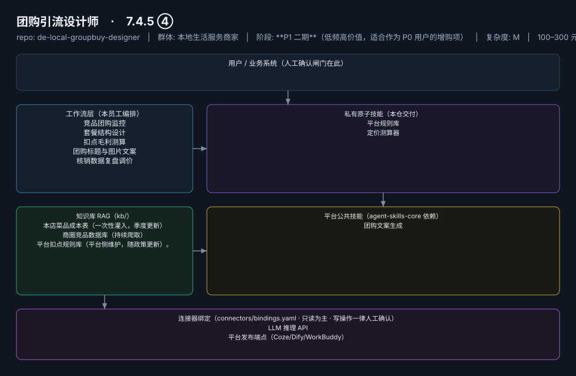
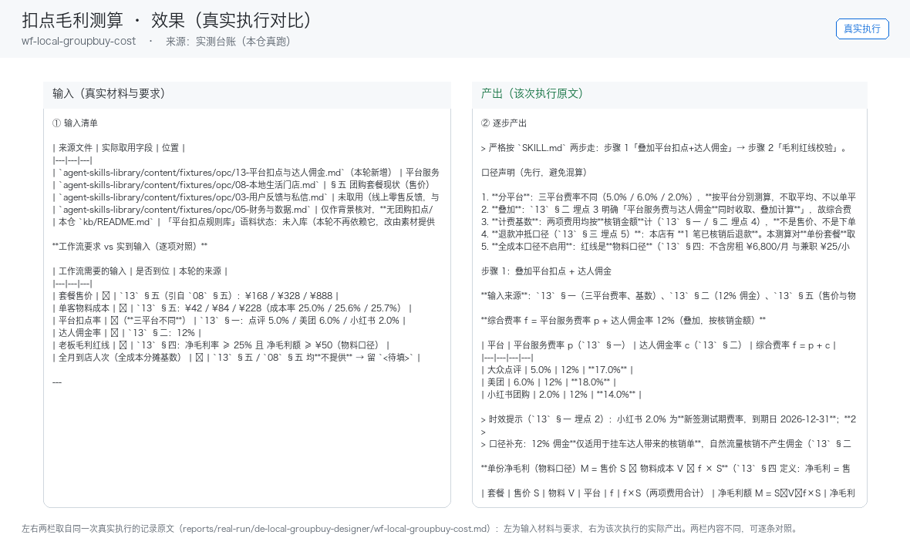

# 团购引流设计师

> 把"被平台牵着走的低价团购"变成"算得清毛利的引流武器"
>
> **7.4.5 ④**　·　本地生活服务商家　·　阶段 **P1 二期**（低频高价值，适合作为 P0 用户的增购项）　·　
> 复杂度 M　·　100–300 元/月，或按套餐策划 200–500 元/次；**代配置服务加成：300–800 元/次**（成本表梳理+首套三级套餐陪跑上架）　·　定义卡 7.4.5 ④

## 演示（真实执行录播）


*真实执行回放（GIF 自动循环，非摆拍）· [▶ 观看完整版 MP4](workflows/wf-local-groupbuy-cost/docs/images/08-demo-run.mp4) · 台账见 [`reports/real-run/wf-local-groupbuy-cost.md`](reports/real-run/wf-local-groupbuy-cost.md)*



## 效果（真实执行）



*上图为**真实效果对比**，不是示意图：左栏是输入材料与要求，右栏是该次执行的产出原文，
两栏取自同一次真实执行记录。*

- 完整台账：[`reports/real-run/wf-local-groupbuy-cost.md`](reports/real-run/wf-local-groupbuy-cost.md)
- 录屏与终端回放：[`workflows/wf-local-groupbuy-cost/docs/images/`](workflows/wf-local-groupbuy-cost/docs/images/)（`08-demo-run.gif` / `08-demo-run.mp4` / `04-terminal-run.png`）
- 使用示例：[`workflows/wf-local-groupbuy-cost/docs/使用示例.md`](workflows/wf-local-groupbuy-cost/docs/使用示例.md)
> 实测判定：**通过**　·　可用度 4/5　·　编造数字 0 处　·　红线命中 0 次 / 拦截 0 次


**一句话**：所有做团购的到店门店

---

## 这个数字员工解决什么问题

Mock 先行（成本表+费率表即可跑 W2/W3）→ 云端定时监控。

| 项 | 内容 |
|---|---|
| 服务对象 | 所有做团购的到店门店 |
| 可量化目标 | 套餐扣点后毛利 ≥ 老板设定红线；团购核销率提升；引流款→利润款转化率可追踪 |
| 投入产出 | 一次避开亏损套餐即可回本；按次收费模式契合"单次 ≤¥300"小额验证硬边界 |
| 需求依据 | D05、D12、D13 |
| 分发渠道 | GitHub（必备）、**闲鱼/淘宝**（"团购套餐策划"按次卖，天然契合）、小红书、Dify Marketplace |

## 30 秒上手

```bash
git clone <本仓库地址> && cd de-local-groupbuy-designer
pip install pyyaml
python3 tests/run.py            # 先跑一遍自检，确认环境与契约都对得上
```

试用（把 `<输入>` 换成本人真实材料）：

```text
请以「团购引流设计师」的身份，帮我跑「竞品团购监控」。
材料如下：<输入>
要求：只使用材料里出现过的数字，缺的写 <待填>；对外文案停在待确认状态。
```

详细接入见 [`docs/01-安装与接入.md`](docs/01-安装与接入.md)。

## 仓库结构

```text
de-local-groupbuy-designer/
├── employee.md            # 人读定义卡（12 主字段 + 2 扩展组，由 employee.yaml 生成）
├── employee.yaml          # 机器契约（能力清单 + 依赖锁）
├── dependencies.yaml      # 对 core 的外部依赖（含版本）
├── persona/               # 运行提示词 / 边界 / KPI
├── skills/                # 私有原子技能（2 个）
├── spec-bindings/         # 有意不公共化能力的本地绑定声明（1 个）
├── workflows/             # 本员工工作流（5 条）
├── kb/                    # 知识库 RAG 契约
├── connectors/            # 连接器绑定（只读为主，写操作人工确认）
├── docs/                  # 六类发布文档
└── tests/                 # 自动化多场景测试
```

## 私有原子技能（2）

| 技能 | slug | 复杂度 | 阶段 | 成熟度 |
|---|---|---|---|---|
| `平台规则库` | `platform-rules-kb` | S | P1 | 契约完备 |
| `定价测算器` | `pricing-calculator` | S | P1 | 契约完备 |

## 平台公共技能依赖（1）

| 技能 | slug | 全平台复用员工数 |
|---|---|---|
| `团购文案生成` | `groupbuy-copy-writer` | 2 |

> 这些技能来自 `agent-skills-core@1.0.0`，本仓库**只引用不复制**。

## Spec 绑定层（1）

| 能力 | slug | 契约位置 | 本仓落点 |
|---|---|---|---|
| `数据对接` | `data-ingest-adapter` | `agent-skills-core/specs/data-ingest-adapter.md` | `spec-bindings/data-ingest-adapter.md` |

> 这一族能力**有意不公共化**（与外部平台接口强绑定）。本仓不存正文，
> 只留本地绑定声明与连接器配置。

## 工作流（5）

| 工作流 | slug | 触发 | 阶段 | 调用技能数 |
|---|---|---|---|---|
| `竞品团购监控` | `wf-local-groupbuy-competitor-monitor` | 定时（每周） | P1 | 1 |
| `套餐结构设计` | `wf-local-groupbuy-structure` | 人工（发起策划） | P1 | 1 |
| `扣点毛利测算` | `wf-local-groupbuy-cost` | 随 W2 联动 | P1 | 2 |
| `团购标题与图片文案` | `wf-local-groupbuy-listing` | 随 W2 联动 | P1 | 1 |
| `核销数据复盘调价` | `wf-local-groupbuy-redemption-review` | 定时（每月） | P2 | 2 |

## 知识库与连接器

- 知识库语料：['本店菜品成本表（一次性灌入，季度更新）', '商圈竞品数据库（持续爬取）', '平台扣点规则库（平台侧维护，随政策更新）。']
- 连接器：LLM 推理 API、平台发布端点（Coze/Dify/WorkBuddy）

## 质量与验收

| 项 | 值 |
|---|---|
| 技能文件数 | 121 |
| 多场景用例数 | 204 |
| 用例通过 | 204 |
| 验收结论 | ✅ 通过 |

完整报告：[`docs/05-验收与测试.md`](docs/05-验收与测试.md)

## 许可

专有许可，详见 [`LICENSE`](LICENSE)。
