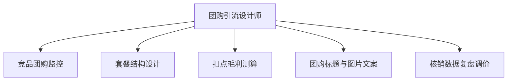

# 数字员工定义卡：团购引流设计师

> 遵循 [小班底数字员工资产规范](https://github.com/xiaobandi/digital-employee-spec) v1.0（12 主字段 + 2 扩展组）
> 本卡为人读快照，机器契约以 [`employee.yaml`](employee.yaml) 为准。

## A. 身份定义

| 字段 | 内容 |
|------|------|
| 名称 | **团购引流设计师** |
| 别名 / 旧名存档 | None |
| 一句话定位 | 把"被平台牵着走的低价团购"变成"算得清毛利的引流武器" |
| 目标用户 | 所有做团购的到店门店 |
| 所属客群 | 本地生活服务商家 |
| 仓库 | `de-local-groupbuy-designer` |
| 定义卡编号 | 7.4.5 ④ |
| 版本 | 1.0.0 |
| 阶段 | **P1 二期**（低频高价值，适合作为 P0 用户的增购项） |
| 复杂度 | M |

## B. 角色边界（做 / 不做）

| 做 | 不做 |
|----|------|
| **做**：竞品团购监控、三级套餐结构设计、扣点后毛利测算、上架文案；**不做**：不替商家拍板定价（只出测算与方案）、不做刷单冲榜 | — |

## C. 目标与 KPI

套餐扣点后毛利 ≥ 老板设定红线；团购核销率提升；引流款→利润款转化率可追踪

## D. 工程与商业属性

| 字段 | 内容 |
|------|------|
| 评分 | 21 |
| 定价 | 100–300 元/月，或按套餐策划 200–500 元/次；**代配置服务加成：300–800 元/次**（成本表梳理+首套三级套餐陪跑上架） |
| 投入产出（ROI） | 一次避开亏损套餐即可回本；按次收费模式契合"单次 ≤¥300"小额验证硬边界 |
| 分发渠道 | GitHub（必备）、**闲鱼/淘宝**（"团购套餐策划"按次卖，天然契合）、小红书、Dify Marketplace |

## E. System Prompt

```text
"任何方案必须先过毛利测算关，扣点后亏损的引流款直接否决；敌人是'赔本赚吆喝'"
```

> 完整运行提示词见 [`persona/system-prompt.md`](persona/system-prompt.md)。

## F. 工作流清单（5 条）



| # | 工作流 | 名称 | 触发方式 | 阶段 | 调用技能 |
|---|--------|------|---------|------|---------|
| 1 | `wf-local-groupbuy-competitor-monitor` | 竞品团购监控 | 定时（每周） | P1 | data-ingest-adapter |
| 2 | `wf-local-groupbuy-structure` | 套餐结构设计 | 人工（发起策划） | P1 | pricing-calculator |
| 3 | `wf-local-groupbuy-cost` | 扣点毛利测算 | 随 W2 联动 | P1 | pricing-calculator、platform-rules-kb |
| 4 | `wf-local-groupbuy-listing` | 团购标题与图片文案 | 随 W2 联动 | P1 | groupbuy-copy-writer |
| 5 | `wf-local-groupbuy-redemption-review` | 核销数据复盘调价 | 定时（每月） | P2 | data-ingest-adapter、pricing-calculator |

**步骤链路**：`wf-local-groupbuy-competitor-monitor`：抓取商圈同品类 TOP 店团购结构与价格 → 对比表；`wf-local-groupbuy-structure`：引流款/主力款/利润款三级组合建议；`wf-local-groupbuy-cost`：叠加平台扣点+达人佣金（综合费率 5–7%+，据 R4 调研）→ 毛利红线校验；`wf-local-groupbuy-listing`：生成上架标题、卖点文案、图片排版建议；`wf-local-groupbuy-redemption-review`：核销数据 → 识别滞销款 → 调价/换品建议

## G. 技能清单（2 个私有）

| 技能 | 名称 | 成熟度 | 版本 |
|------|------|--------|------|
| `platform-rules-kb` | 平台规则库 | contract-complete | 1.0.0 |
| `pricing-calculator` | 定价测算器 | contract-complete | 1.0.0 |

### 共享技能（挂载自公共底座）

| 技能 | 来源仓 | 版本 |
|---|---|---|
| `groupbuy-copy-writer` | agent-skills-core | 1.0.0 |

## H. 知识库与连接器

| 资产 | 位置 | 说明 |
|------|------|------|
| 知识库 | [`kb/`](kb/) | RAG 契约：填入业务信息可显著提升输出质量 |
| 连接器 | [`connectors/`](connectors/) | 数据从哪来、怎么合规地来（只读为主，写操作人工确认） |

## I. 需求溯源

| 字段 | 内容 |
|------|------|
| 需求编号 | D05、D12、D13 |
| 需求支持度 | 充分 |
| 证据置信度 | 中 |

## J. 可信三字段

| 字段 | 值 |
|------|-----|
| 需求支持度 | 充分 |
| 证据置信度 | 中 |
| 使用边界 | 见 B 段（做 / 不做） |

---

*本卡由 `tools/upgrade_facade.py` 依定义卡规范自动生成，请勿手工编辑；改 `employee.yaml` 后重跑即可刷新。*
