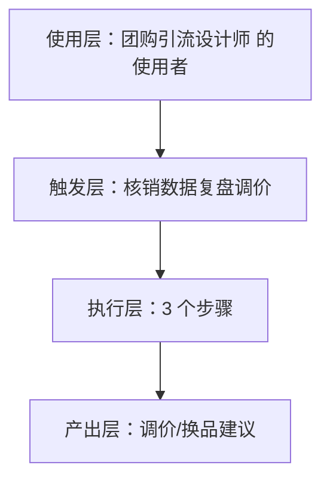
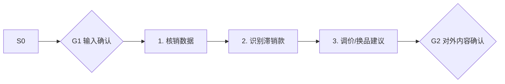

# 核销数据复盘调价 · 架构与流程图

## 本工作流的四层结构

| 层 | 内容 |
|---|---|
| 使用层 | 所有做团购的到店门店；员工定位：把"被平台牵着走的低价团购"变成"算得清毛利的引流武器" |
| 触发层 | 关键词 / 显式点名「核销数据复盘调价」；触发方式：定时（每月） |
| 执行层 | 核销数据 → 识别滞销款 → 调价/换品建议 |
| 产出层 | 调价/换品建议 |

## 执行流程

## 步骤职责表

| # | 步骤 | 承担者 | 为什么 |
|---|---|---|---|
| 1 | 核销数据 | 模型 | 需要读懂语境，不可用固定规则替代 |
| 2 | 识别滞销款 | 模型 | 需要读懂语境，不可用固定规则替代 |
| 3 | 调价/换品建议 | 模型 | 需要读懂语境，不可用固定规则替代 |

⚠️ 尚未补齐：图中的步骤来自注册表口径，未逐条实跑校验；实跑后请同步修订本页（`发布标准.md` 第六项：通读一遍，不得出现重复填充句）。
